# Virtual Machines and the Linux OS: Practical Assignment

A hands-on Linux administration practical. We built a Kali Linux virtual machine in Oracle VirtualBox, then used it to monitor the system, find and stop processes, explore the `/proc` file system, install software from the command line, and work with files and folders.

> **Group project:** Department of Electrical, Electronic and Computer Engineering, Cape Peninsula University of Technology (CPUT), May 2026.
> Repository maintained by **Lekgothe Ngoepe**.
> **My role:** _[VM setup and process management sections]_

---

## Skills shown

| Area | What was done |
|---|---|
| Virtualisation | Created and configured a VirtualBox VM (2 GB RAM, 2 vCPU, 25 GB disk, bridged network) |
| Linux install | Installed Kali Linux (Debian-based) from the ISO installer |
| Monitoring | Task Manager, `vmstat -s`, `top`, `ps aux` |
| Process control | Found a process with `ps aux \| grep`, stopped it with `kill`, confirmed it was gone |
| `/proc` file system | Read a process's status from `/proc/<pid>/status` and interpreted it |
| Package management | `apt update`, `apt install`, downloaded a `.deb` with `wget`, installed it with `gdebi` |
| Files and folders | `cd`, `mkdir`, `cp`, `cat`, `head`, `tee -a` |

---

## 1. Virtual machine setup

Kali Linux was installed in Oracle VirtualBox with 2048 MB RAM, 2 processors and a 25 GB dynamically allocated disk. The network adapter was bridged to the host's Wi-Fi.

| VM summary | Disk | VM settings |
|---|---|---|
| 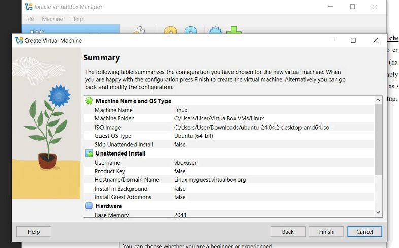 |  | 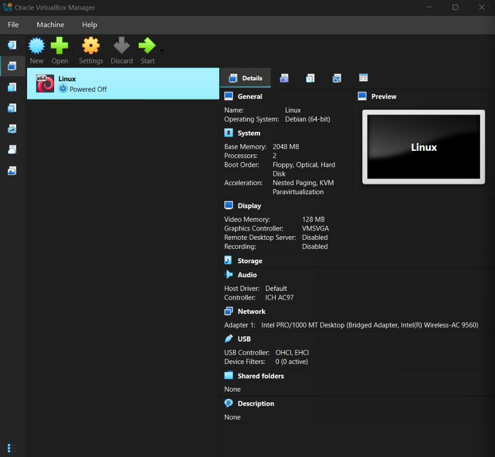 |

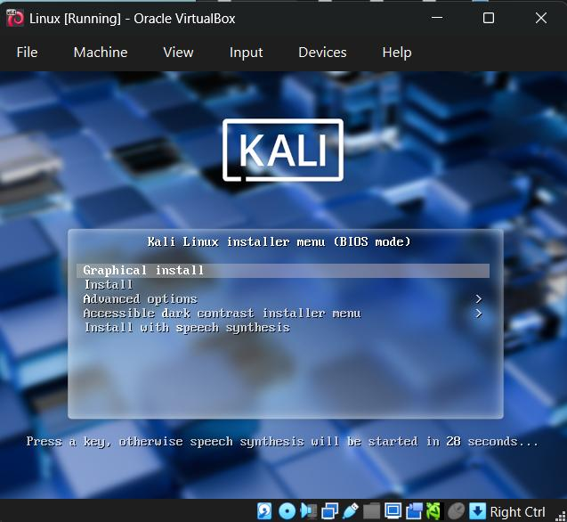

## 2. System monitoring

| Tool | Shows |
|---|---|
| Task Manager (GUI) | Running tasks, CPU and memory usage |
| `vmstat -s` | Memory statistics: total, used and free memory, swap, paging activity, CPU ticks |
| `top` | A live, refreshing view of processes, CPU and memory per process, load average and uptime |
| `ps aux` | A one-off snapshot of every running process |

**`ps aux` vs `top`:** `ps aux` is a snapshot taken at one moment. `top` keeps refreshing every few seconds, so it is better for watching how the system behaves live.

| Task Manager | `vmstat -s` |
|---|---|
| 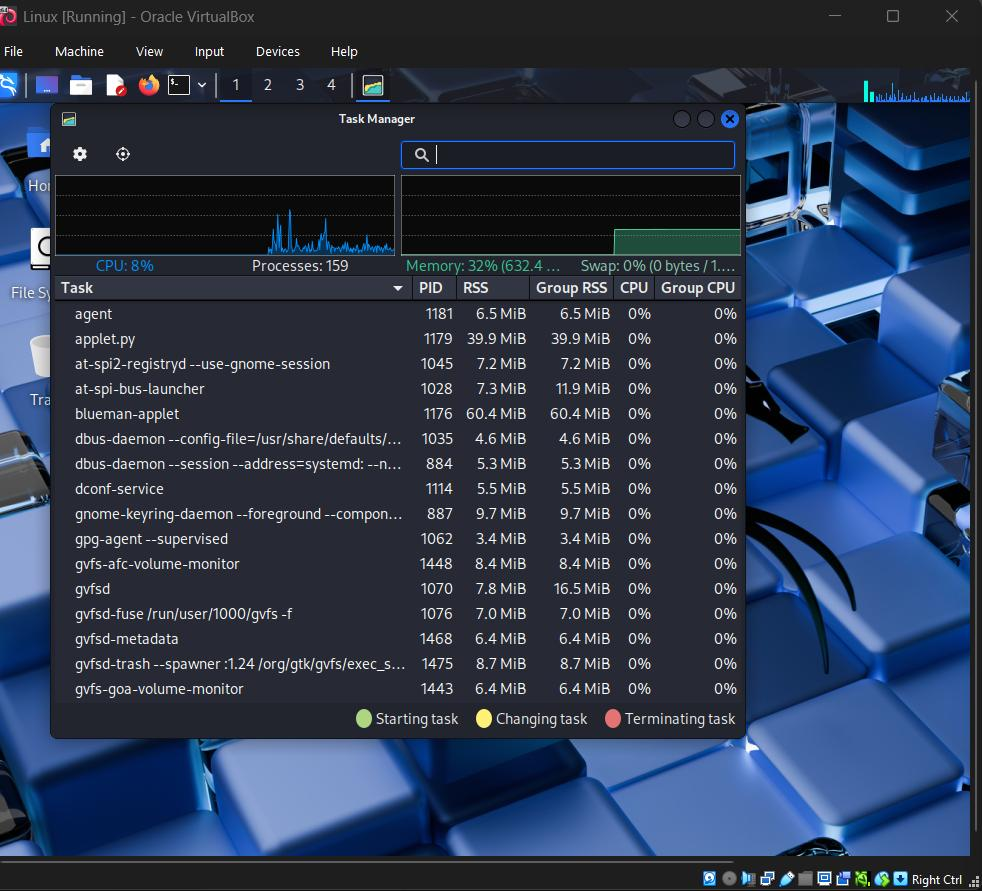 | 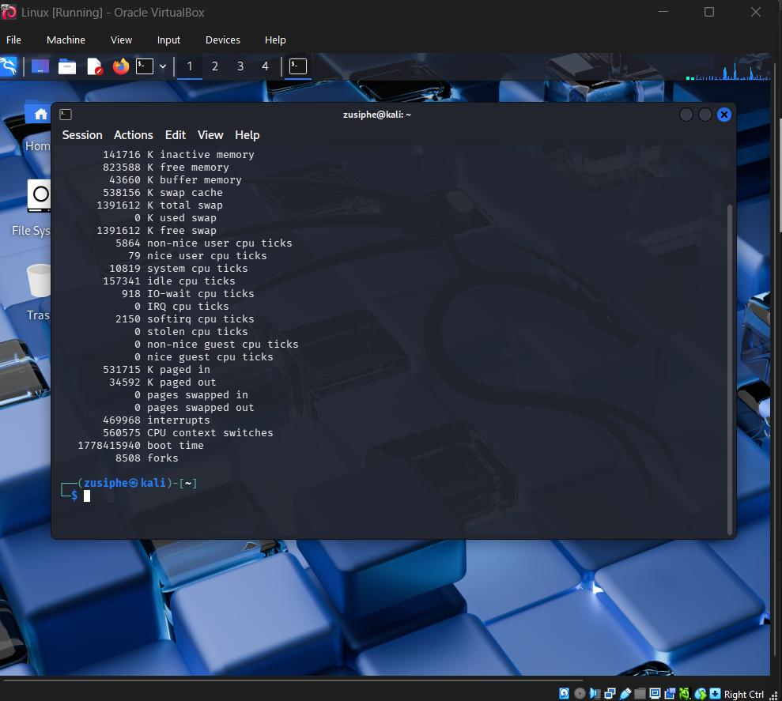 |

| `top` | `ps aux` |
|---|---|
| 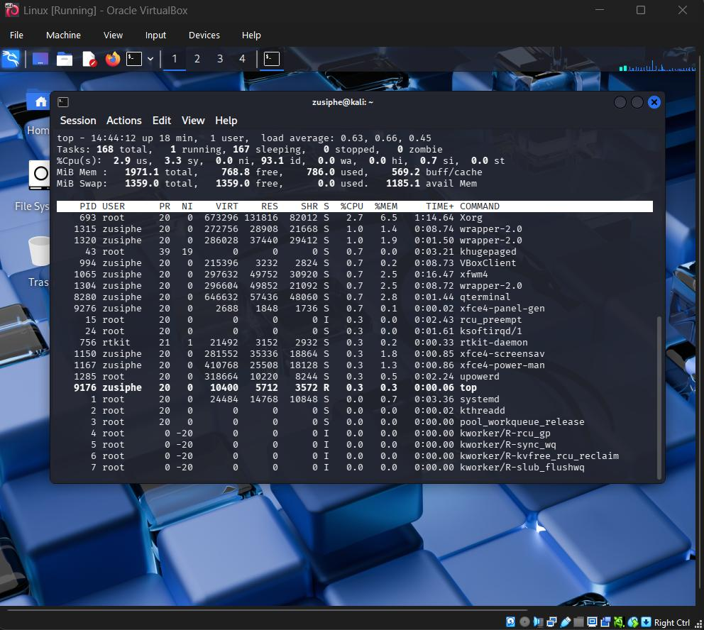 | 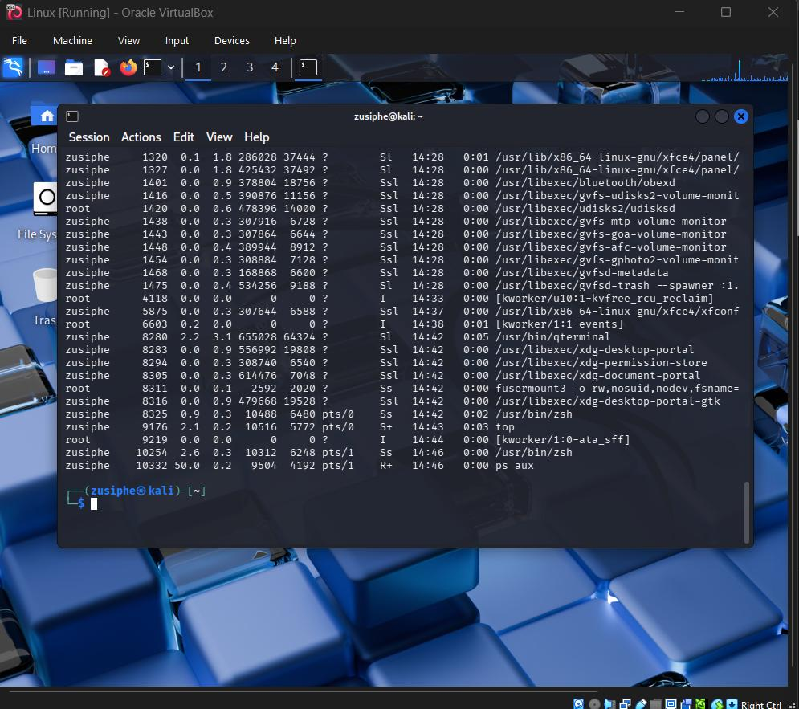 |

## 3. Finding and stopping a process

```bash
ps aux | grep firefox     # find Firefox and its process IDs (PIDs)
kill 21984                # stop the main (lowest) Firefox PID
ps aux | grep firefox     # only the grep line is left, so Firefox has closed
```

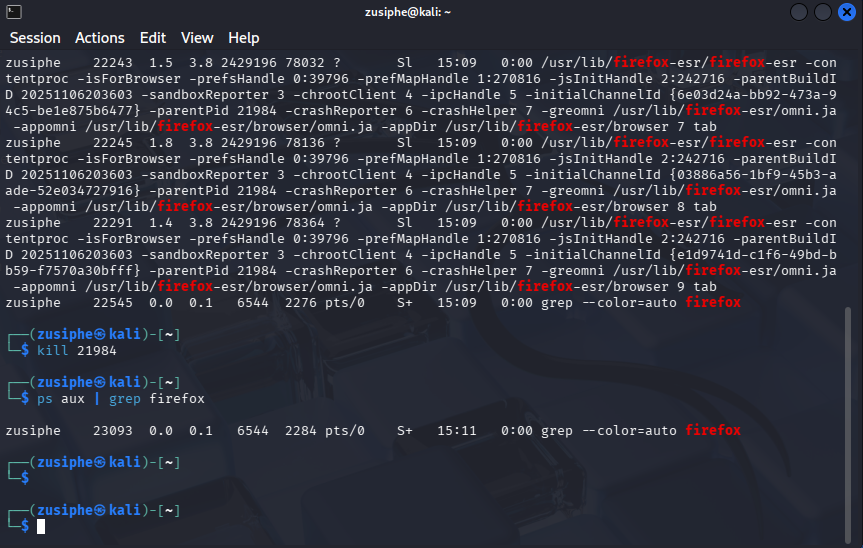

## 4. Exploring `/proc`

`cat /proc/6/status` was used to read details of a kernel process:

| Field | Value |
|---|---|
| Name | `kworker/R-kvfree_rcu_reclaim` |
| Umask | 0000 |
| State | I (idle) |
| Tgid / Pid | 6 / 6 |
| Ngid | 0 |
| PPid | 2 (`kthreadd`, the kernel thread creator) |

This is a kernel worker thread. It frees memory released with `kvfree()` once an RCU (Read-Copy-Update) grace period has passed, so the cleanup happens in the background without slowing the system down. Being idle is normal: it is waiting for work.

## 5. Installing an application from the command line

```bash
sudo apt update                                   # refresh package lists
sudo apt install gdebi-core wget                  # tools for .deb installs
wget -O ~/discord.deb "https://discordapp.com/api/download?platform=linux&format=deb"
sudo gdebi ~/discord.deb                          # install, resolving dependencies
```

| `apt update` | `apt install` |
|---|---|
| 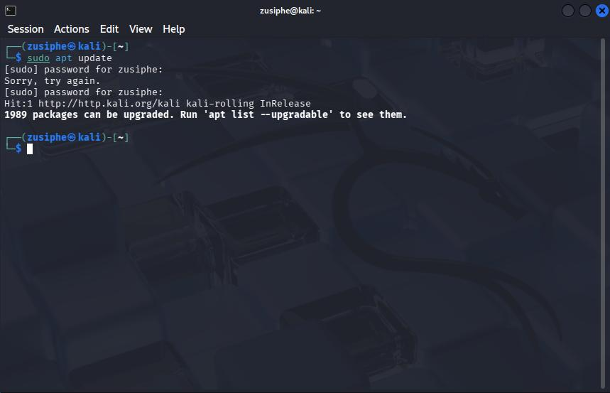 | 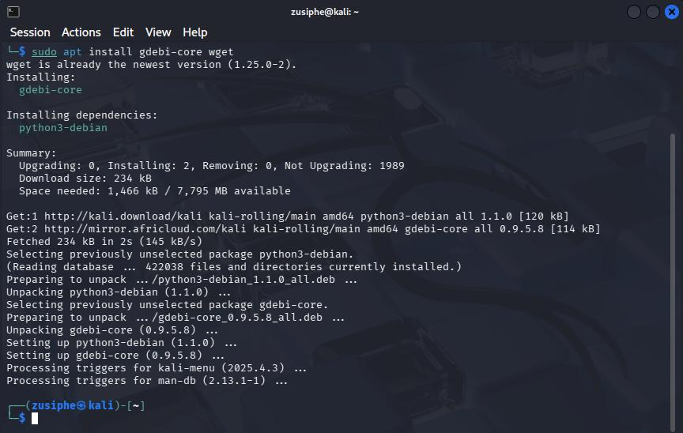 |

| `wget` download | `gdebi` install | Discord running |
|---|---|---|
| 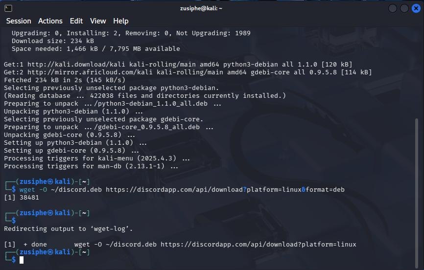 | 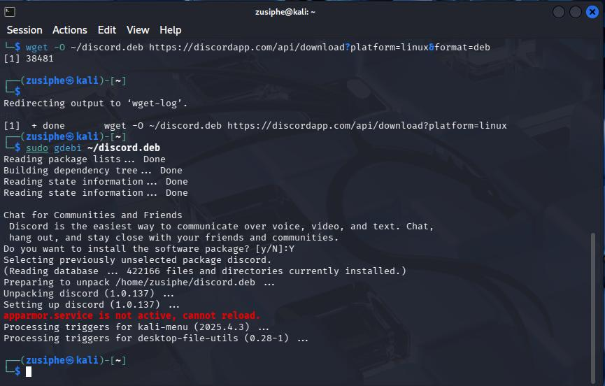 | 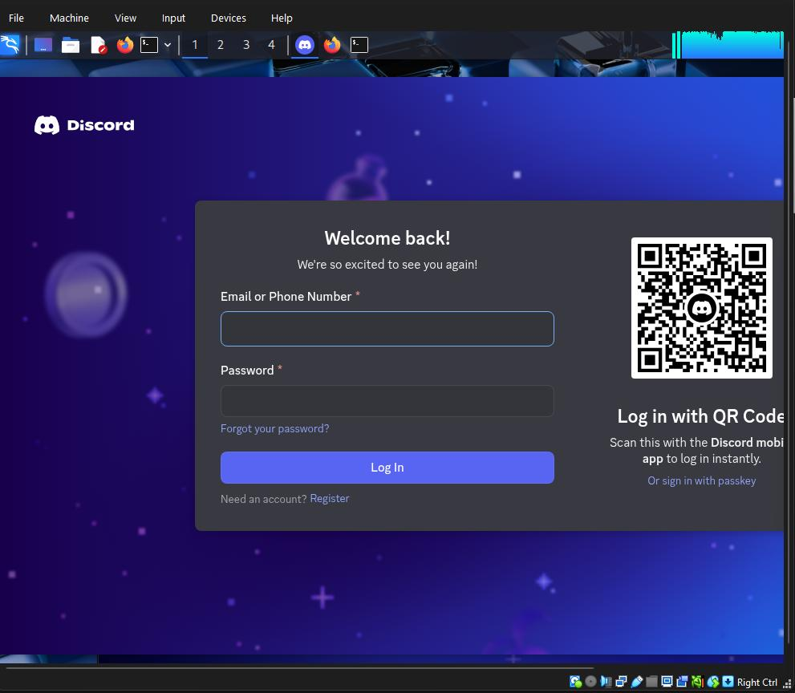 |

**Why `sudo`?** `sudo` ("superuser do") runs a command with root privileges. It is needed for system-level tasks such as updating package lists, installing software or changing system files, which a normal user cannot do.

## 6. Working with files

```bash
cd ~/Desktop
cat group.txt                                     # view the file
echo "..." | sudo tee -a group.txt                # append a line
mkdir myfolder && cp group.txt myfolder/
cd myfolder && head group.txt                     # first 10 lines
```

_(The screenshots for this part are left out because they contain group members' student numbers.)_

## What we learned

The practical gave hands-on experience with core operating-system ideas inside a safe virtual machine:
- how a hypervisor shares the host's CPU, RAM and disk with a guest
- how Linux exposes processes through tools like `top` and `ps`, and through the `/proc` file system
- how to install software safely with package managers and `sudo`

## Tools

Oracle VirtualBox · Kali Linux · Bash · apt · gdebi · wget
